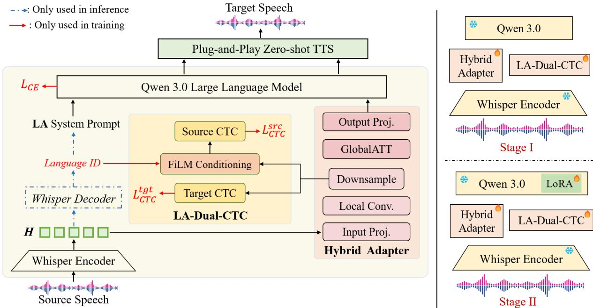

---

title: "S2ST-Omni: Hierarchical Language-Aware SpeechLLM Adaptation for Multilingual Speech-to-Speech Translation"

date: "2026-11-28"

year: "2026"

venue_type: "arXiv预印本"

venue_name: ""

categories: ["未分类"]

tags: ["论文速读"]

slug: "paper-2026.findings-acl.1004-4c94161f"

---

# S2ST-Omni: Hierarchical Language-Aware SpeechLLM Adaptation for Multilingual Speech-to-Speech Translation

该文提出组合式语音到语音翻译框架S2ST-Omni，用局部到全局的混合适配器桥接Whisper-large-v3与Qwen3-4B，并在声学层用FiLM式LA-Dual-CTC、语言层用动态语言提示注入源语言信息，配合两阶段渐进微调。CVSS-C上平均BLEU达35.67、ASR-BLEU达33.45，优于StreamSpeech等强基线，TTS后端可即插即换。

## 研究问题

现有组合式语音到语音翻译系统在预训练语音与语言模型之间接口过浅，且未显式建模源语言信息，导致多语翻译精度与鲁棒性不足。

## 方法：核心思路与整体框架

以Whisper-large-v3编码器加Qwen3-4B为骨干，设计局部到全局的混合语音适配器、声学级LA-Dual-CTC与语言级LAP构成的分层语言感知架构，并采用两阶段渐进微调。

图示解释：Overall architecture of the proposed S2ST-Omni framework. LA denotes language-aware.

## 创新点

提出分层语言感知架构，在声学层用FiLM式LA-Dual-CTC、在语言层用动态语言提示注入源语言信息，并配合局部到全局混合适配器与两阶段渐进微调。

## 实验：数据、基线与结果

### 数据集与设置

原文或 FactPack 未提供，待核验。

### Benchmark 与结果

CVSS-C Fr→En：BLEU 35.83，ASR-BLEU 33.20

CVSS-C Es→En：BLEU 37.85，ASR-BLEU 35.90

CVSS-C De→En：BLEU 33.34，ASR-BLEU 31.25

平均BLEU 35.67、ASR-BLEU 33.45，优于StreamSpeech的28.77/25.54

COMET：Fr→En 81.94、Es→En 83.39、De→En 80.73

语言识别复用Whisper特征达99.67–99.80%准确率，额外延迟22.8 ms

### 消融实验

原文或 FactPack 未提供，待核验。

## 总结

工程上可把S2TT前端与TTS后端解耦，用轻量适配器桥接Whisper与LLM，并以显式语言条件加两阶段微调稳定对齐再提升翻译。

## References

- [论文](https://aclanthology.org/2026.findings-acl.1004/)

[2026.findings-acl.1004.pdf](/papers/2026.findings-acl.1004.pdf)
