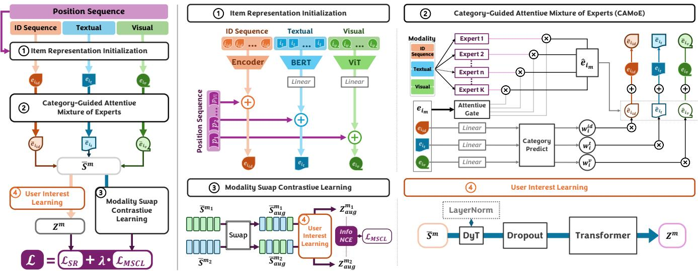
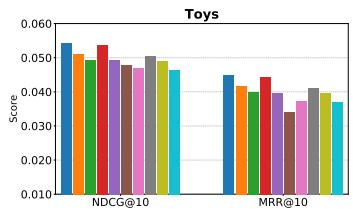
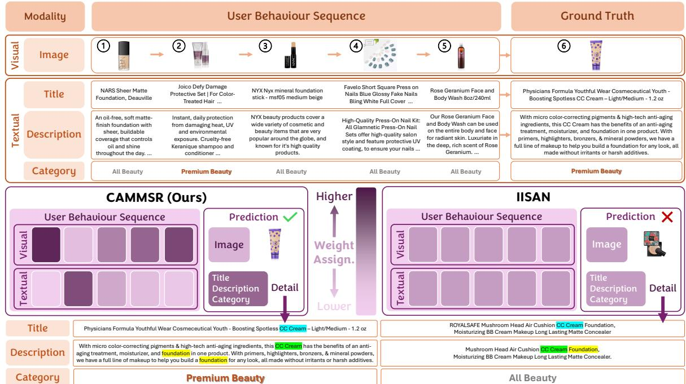

---

title: "CAMMSR：面向多模态序列推荐的类别引导注意力专家混合模型"

date: "2026-03-04"

year: "2026"

venue_type: "arxiv预印本"

venue_name: "arXiv"

categories: ["推荐系统"]

tags: ["论文速读", "Mixture of Experts", "类别引导", "对比学习", "多模态融合", "序列推荐"]

slug: "paper-2603.04320"

---

[论文链接](https://arxiv.org/abs/2603.04320)

## 一、研究背景与问题

随着信息丰富环境中多媒体数据的爆炸式增长，个性化内容发现变得愈发困难，推荐系统由此成为一种重要的被动式数据管理手段。序列推荐通过建模用户行为的时间动态来推断其兴趣演化，而多模态序列推荐进一步引入物品的文本、图像等异构信息，以构建更细粒度的物品表示并更深入地理解用户意图。

然而，现有大多数多模态序列模型依赖启发式融合策略，难以刻画用户—模态交互的动态性与上下文敏感性。在真实场景中，用户对模态的偏好不仅因人而异，同一用户在不同物品或不同类别上也会发生变化：例如浏览美妆商品时视觉外观可能占主导，而购买游戏时文本描述更具指导性。此外，模态之间的协同效应——单一模态无法激发的兴趣在互补信号共同出现时被触发——在以往工作中仍鲜有探索。

为此，本文提出 CAMMSR，一种类别引导的注意力专家混合模型用于多模态序列推荐。其核心是类别引导注意力专家混合模块（CAMoE），从多视角学习专门的物品表示并显式建模模态间协同；该模块借助辅助的类别预测任务动态分配模态权重，实现多模态信号的自适应融合。同时，本文设计了模态交换对比学习任务，通过序列级增强强化跨模态表示对齐。本文的主要贡献包括：首次利用辅助类别预测任务来分配模态权重以提升多模态序列推荐性能；提出能够从多视角捕获信息性物品表示与用户偏好、并探索模态协同的 CAMoE 模块；引入定制的模态交换对比学习任务以增强跨模态对齐；在四个公开数据集上的实验验证了 CAMMSR 的有效性。

## 二、方法

CAMMSR 由四个主要部分组成：物品表示初始化、类别引导注意力专家混合、用户兴趣学习以及模态交换对比学习。

在物品表示初始化阶段，模型从 ID、文本与视觉三种模态获取物品表示。文本特征由预训练 BERT 提取，视觉特征由预训练 ViT 提取，并通过线性投影将维度对齐到 ID 模态的维度，随后为所有模态加入位置嵌入：

$$

\mathbf{e}_{i_m} = x_{i_m} + p_i,\tag{1}

$$

其中 $m \in \{id, t, v\}$ 表示模态。

类别引导注意力专家混合（CAMoE）模块针对每个目标模态，将三种模态表示拼接后送入多个专家网络，以显式引入其他模态的信息并建模模态协同：

$$

\hat{\mathbf{e}}_{i_m} = \sum_{k=1}^{K} g_k^m \operatorname{Expert}_k(\operatorname{Con}(\mathbf{e}_{i_{id}}, \mathbf{e}_{i_t}, \mathbf{e}_{i_v})),\tag{2}

$$

其中 $K$ 为每个模态的专家数量，组合权重 $g_k^m$ 由注意力门控路由器给出：

$$

G^m = \operatorname{Softmax}(Q^m (K^m)^T / \sqrt{K}) V^m.\tag{3}

$$

为缓解数据稀疏下模态权重难以学习的问题，模型引入辅助类别预测任务：对物品 $i$ 在模态 $m$ 上的表示计算其属于各类别的概率 $\hat{y}_c^m$，并以二元交叉熵度量真实类别标签与预测标签之间的差异 $d_i^m$，进而得到模态权重：

$$

w_i^m = \frac{\exp(d_i^m)}{\sum_{n \in \{id, t, v\}} \exp(d_i^n)}.\tag{4}

$$

最终物品表示由原始表示与加权专家输出相加得到：

$$

\bar{\mathbf{e}}_{i_m} = \mathbf{e}_{i_m} + w_i^m \hat{\mathbf{e}}_{i_m}.\tag{5}

$$

在用户兴趣学习阶段，各模态的增强序列 $\bar{S}^m$ 经模态特定的 Transformer 编码器处理，得到用户兴趣表示 $\mathbf{Z}^m$。受近期研究启发，模型探索以动态 Tanh（DyT）替代 LayerNorm：

$$

\operatorname{DyT}(x) = \operatorname{Tanh}(\alpha x),\tag{6}

$$

其中 $\alpha$ 为可学习参数。最终预测分数由各模态得分求和得到：

$$

\hat{y}_i = \sum_{m \in \{id, t, v\}} \mathbf{Z}^m \mathbf{e}_{i_m}.\tag{7}

$$

模态交换对比学习任务对每一对模态 $\langle m_1, m_2 \rangle$，以概率 $\rho$ 随机交换两条序列中的物品表示构造增强视图，并在批内采用 InfoNCE 损失拉近正对、推远负对：

$$

\mathcal{L}_{MSCL}^{m_{1,2}} = - \sum_{i=1}^{|\mathcal{B}|} \log \frac{\exp(\operatorname{Sim}(\mathbf{Z}_{aug,i}^{m_1}, \mathbf{Z}_{aug,i}^{m_2}))}{\sum_{j=1}^{|\mathcal{B}|} \exp(\operatorname{Sim}(\mathbf{Z}_{aug,i}^{m_1}, \mathbf{Z}_{aug,j}^{m_2}))}.\tag{8}

$$

模型以主序列推荐交叉熵损失与对比损失的加权和作为最终优化目标：

$$

\mathcal{L} = \mathcal{L}_{SR} + \lambda \mathcal{L}_{MSCL}.\tag{9}

$$

该图展示了 CAMMSR 的整体框架。左侧概述处理流程，右侧展开各组件：物品表示初始化利用预训练提取器结合位置序列得到多模态物品表示；类别引导注意力专家混合借助额外的类别预测任务与注意力机制分配模态权重；模态交换对比学习通过模态交换构造增强视图以强化跨模态对齐；用户兴趣学习使用基于 Transformer 的编码器建模行为序列，并探索以 DyT 替代 LayerNorm。

## 三、实验

实验在 Toys、Games、Beauty 与 Home 四个公开真实数据集上进行，均采用 5-core 过滤并按时间戳构造行为序列。评价指标为 NDCG@K 与 MRR@K（$K \in \{5, 10\}$），采用留一法并在全物品集上排序。基线涵盖传统序列方法（GRU4Rec、SASRec、LRURec、FEARec、TiCoSeRec）与多模态序列方法（NOVA、DIF-SR、UniSRec、MISSRec、M3SRec、IISAN、MMMLP、TedRec、FindRec）。

整体对比（RQ1）表明，CAMMSR 在所有数据集与指标上均取得统计显著的最优结果。相较最强基线，其在 Toys 上 NDCG@5 相对提升 14.66%、MRR@5 提升 15.98%，在 Games、Beauty、Home 上 NDCG@5 分别提升 6.67%、15.32% 与 10.53%。同时，移除 CAMoE 后推荐精度反而提升的测试样本比例不足 1%，说明该模块具有良好的泛化性与稳定性。

消融实验（RQ2）比较了 w/o Att.、w/o CG、w/o DyT、r CMoE 与 r MoE 等变体，结果显示各组件均有贡献：注意力门控优于线性门控，类别引导融合显著优于等权融合，DyT 可取得与 LayerNorm 相当甚至更优的性能，CAMoE 优于跨模态 MoE 与原始 MoE。关于模态交换对比学习的模态对选择，引入更多模态对可带来更高性能；仅选单一模态对时，视觉与文本的组合最优，作者推测这是因为二者语义鸿沟较大，对比学习能有效缓解该鸿沟。

类别噪声研究（RQ3）模拟了标签删除与标签误导两类损坏。结果显示删除条件下的性能下降始终小于误导条件；即便在 20% 误导噪声下，CAMMSR 仍优于 w/o CG 变体，说明类别引导机制在现实标签质量范围内仍能带来净收益。多模态必要性分析（RQ4）表明移除文本或视觉模态均导致性能下降，且移除视觉的变体优于移除文本的变体，说明文本信息与物品特性的语义对齐更强。

效率研究（RQ5）显示 CAMMSR 在 Games 与 Beauty 上每轮训练时间具有竞争力，且收敛所需轮数最少（分别为 65 与 53 轮），总训练时间最短，推理时间仅次于 DIF-SR。案例研究（RQ6）以 Beauty 数据集的一条购买序列为例，CAMMSR 与 IISAN 均识别出宽泛品类，但 CAMMSR 唯一命中了与用户偏好模式一致的真实目标物品，体现出类别相关的自适应模态加权能力。超参数分析（RQ7）表明专家数 $K=4$ 时性能最佳，过多专家会因过度专门化与路由复杂度上升而退化；权重超参数 $\lambda$ 在多数数据集上取 0.25 为宜，而稀疏度更高的 Home 数据集取 0.5 更优。此外，类别分析在 Amazon Baby 与 Microlens 数据集上验证了类别引导融合在多标签类别、层级类别以及借助大模型生成虚拟类别的无类别场景下均能带来稳定提升。

该图给出 Toys 数据集上的消融结果，对比 CAMMSR 与 w/o Att.、w/o CG、w/o DyT、r CMoE、r MoE 等变体的性能，用于说明注意力门控、类别引导融合、DyT 层以及 CAMoE 设计各自的贡献。

该图展示 Beauty 数据集上的案例研究，对比一条购买序列下 CAMMSR 与 IISAN 的预测结果。两个模型都识别出宽泛品类，但 CAMMSR 命中了与用户偏好模式一致的真实目标物品，体现出类别引导的注意力机制能够按类别自适应地放大文本等更具判别力的模态信号。

## 四、总结

本文提出了 CAMMSR，一种面向多模态序列推荐的类别引导注意力专家混合框架，用以克服现有多模态模型中静态融合策略的局限。CAMMSR 整体整合用户行为序列及其时间戳对应的多模态内容，从而生成更具上下文感知能力的推荐。其核心的 CAMoE 模块既从多视角捕获专门的物品表示，又显式建模模态间的协同交互；通过辅助类别预测任务动态分配模态权重，模型实现了与物品特性和用户上下文偏好相一致的自适应多模态融合。此外，模态交换对比学习任务通过序列级增强强化了跨模态对齐与表示一致性。在四个真实数据集上的大量实验验证了所提模型的有效性与高效性。

未来工作方面，CAMMSR 为自适应多模态推荐提供了灵活的基础：可将类别引导推广到其他上下文维度，发展更精细的协同建模方法，并将该框架迁移到传统推荐之外的序列决策任务中。

## References

- J. Xu, Z. Chen, W. Wang, X. Hu, S.-W. Kim, and E. C. Ngai, “[Cohesion: Composite graph convolutional network with dual-stage fusion for multimodal recommendation](https://doi.org/10.1145/3726302.3729927),” in Proceedings of the 48th International ACM SIGIR Conference on Research and Development in Information Retrieval, 2025, pp. 1830–1839.

- X. He, K. Deng, X. Wang, Y. Li, Y. Zhang, and M. Wang, “[Lightgcn: Simplifying and powering graph convolution network for recommendation](https://arxiv.org/abs/2002.02126),” in Proceedings of the 43rd International ACM SIGIR conference on research and development in Information Retrieval, 2020, pp. 639–648.

- J. Xu, Z. Chen, S. Yang, J. Li, and E. C. Ngai, “[The best is yet to come: Graph convolution in the testing phase for multimodal recommendation](https://doi.org/10.1145/3746027.3755781),” in Proceedings of the 33rd ACM International Conference on Multimedia, 2025, pp. 6325–6334.

- Z. Guo, J. Li, G. Li, C. Wang, S. Shi, and B. Ruan, “[Lgmrec: Local and global graph learning for multimodal recommendation](https://doi.org/10.1609/aaai.v38i8.28688),” in Proceedings of the AAAI Conference on Artificial Intelligence, vol. 38, no. 8, 2024, pp. 8454–8462.

- J. Xu, Z. Chen, S. Yang, J. Li, Z. Wan, H. Wang, W. Liu, Y. Li, and E. C. Ngai, “[Vi-mmrec: Similarity-aware training cost-free virtual user-item interactions for multimodal recommendation](https://arxiv.org/abs/2512.08702),” arXiv preprint arXiv:2512.08702, 2025.

- Z. Chen, J. Xu, H. Wang, S. Yang, Z. Wan, and H. Hu, “[Hypercomplex prompt-aware multimodal recommendation](https://doi.org/10.1145/3746252.3761174),” in Proceedings of the 34th ACM International Conference on Information and Knowledge Management, 2025, pp. 403–414.

- Z. Chen, J. Xu, Y. Wei, and Z. Peng, “[Squeeze and excitation: A weighted graph contrastive learning for collaborative filtering](https://doi.org/10.1145/3726302.3730251),” in Proceedings of the 48th International ACM SIGIR Conference on Research and Development in Information Retrieval, 2025, pp. 2769–2773.

- J. Xu, Z. Chen, S. Yang, J. Li, H. Wang, W. Wang, X. Hu, and E. Ngai, “[Nlgcl: Naturally existing neighbor layers graph contrastive learning for recommendation](https://doi.org/10.1145/3705328.3748059),” in Proceedings of the Nineteenth ACM Conference on Recommender Systems, 2025, pp. 319–329.

- J. Xu, Z. Chen, J. Li, S. Yang, W. Wang, H. Wang, Y. Li, X. Hu, and E. Ngai, “[Dggvae: Dual-granularity graph variational auto-encoder for group recommendation](https://doi.org/10.1145/3785145),” ACM Transactions on Information Systems, vol. 44, no. 2, pp. 1–30, 2026.

- F. Sun, J. Liu, J. Wu, C. Pei, X. Lin, W. Ou, and P. Jiang, “[Bert4rec: Sequential recommendation with bidirectional encoder representations from transformer](https://arxiv.org/abs/1904.06690),” in Proceedings of the 28th ACM international conference on information and knowledge management, 2019, pp. 1441–1450.

- W.-C. Kang and J. McAuley, “[Self-attentive sequential recommendation](https://doi.org/10.1109/icdm.2018.00035),” in 2018 IEEE international conference on data mining (ICDM). IEEE, 2018, pp. 197–206.

- Y. Dang, E. Yang, G. Guo, L. Jiang, X. Wang, X. Xu, Q. Sun, and H. Liu, “[Ticoserec: Augmenting data to uniform sequences by time intervals for effective recommendation](https://doi.org/10.1109/tkde.2023.3324312),” IEEE Transactions on Knowledge and Data Engineering, vol. 36, no. 6, pp. 2686–2700, 2023.

- X. Du, H. Yuan, P. Zhao, J. Qu, F. Zhuang, G. Liu, Y. Liu, and V. S. Sheng, “[Frequency enhanced hybrid attention network for sequential recommendation](https://doi.org/10.1145/3539618.3591689),” in Proceedings of the 46th International ACM SIGIR conference on research and development in information retrieval, 2023, pp. 78–88.

- J. Xu, Z. Chen, S. Yang, J. Li, H. Wang, and E. C. Ngai, “[Mentor: multi-level self-supervised learning for multimodal recommendation](https://doi.org/10.1609/aaai.v39i12.33408),” in Proceedings of the AAAI Conference on Artificial Intelligence, vol. 39, no. 12, 2025, pp. 12908–12917.

- Z. Chen, J. Xu, and H. Hu, “[Don’t lose yourself: Boosting multimodal recommendation via reducing node-neighbor discrepancy in graph convolutional network](https://doi.org/10.1109/icassp49660.2025.10887910),” in ICASSP 2025-2025 IEEE International Conference on Acoustics, Speech and Signal Processing (ICASSP). IEEE, 2025, pp. 1–5.

